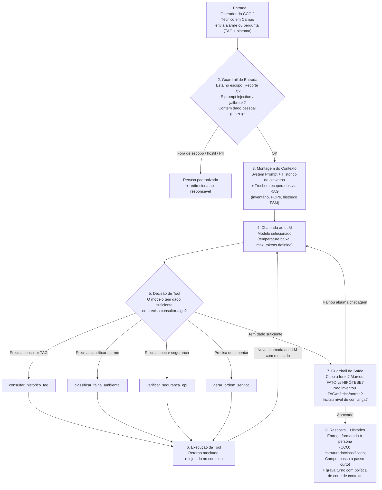

# Fluxograma da Arquitetura — engman-copilot (Recorte B)

Diagrama em Mermaid (renderizado nativamente pelo GitHub). Cobre os 8 blocos essenciais exigidos pelo Challenge, nomeados com os elementos reais do projeto (TAG, histórico de falhas, POP, criticidade, OS).

## Descrição bloco a bloco

| # | Bloco | O que entra | O que é processado | O que sai |
|---|-------|--------------|---------------------|-----------|
| 1 | Entrada | Texto livre do Operador do CCO ou Técnico em Campo | Identificação de persona e intenção (triagem, consulta, geração de OS) | Mensagem normalizada para o guardrail |
| 2 | Guardrail de entrada | Mensagem normalizada | Checagem contra o escopo do Recorte B, detecção de jailbreak/prompt injection e de dados pessoais (placas, imagens, dados de funcionário) | Aprovação para seguir ou recusa padronizada imediata (sem chamar o LLM) |
| 3 | Montagem do contexto | Mensagem aprovada | Concatenação do `system_prompt.md`, histórico recente da conversa e trechos recuperados por RAG na base de conhecimento (busca híbrida semântica + TAG) | Prompt completo pronto para o modelo |
| 4 | Chamada ao LLM | Prompt completo | Inferência do modelo com parâmetros definidos (temperature baixa para reduzir alucinação) | Resposta preliminar ou decisão de usar tool |
| 5 | Decisão de tool | Resposta preliminar do modelo | Avaliação se há dado suficiente no contexto ou se é necessário acionar uma das 4 tools especificadas | Chamada de tool ou segue direto para o guardrail de saída |
| 6 | Execução da tool | Parâmetros da tool escolhida (ex: `tag`) | Execução mockada (retorno simulado conforme `tools_spec.json`) | Resultado reinjetado no contexto, nova chamada ao LLM |
| 7 | Guardrail de saída | Resposta gerada pelo modelo | Verificação final: cita fonte? distingue FATO de HIPÓTESE? não inventou dado? tem nível de confiança? está dentro do escopo? | Aprovação da resposta ou nova geração (volta ao bloco 4) |
| 8 | Resposta + histórico | Resposta aprovada | Formatação de acordo com a persona (estruturado para CCO, passo a passo para Campo) e gravação do turno | Resposta final ao usuário + histórico atualizado com política de corte de contexto |

## Decisões mais importantes do fluxo

1. **Guardrail de entrada antes do LLM:** recusas por escopo, jailbreak ou dado pessoal são resolvidas sem sequer chamar o modelo — reduz custo, latência e superfície de ataque de prompt injection.
2. **Guardrail de saída pode reenviar ao LLM:** se a resposta gerada falhar em qualquer checagem (ex: não citou fonte, não marcou FATO vs HIPÓTESE), o fluxo não entrega a resposta ao usuário — força nova geração até passar nas checagens, evitando que alucinação chegue ao operador.
